 

---

## 👋 About me

I'm a computer science student who builds software that solves real problems. My work spans **AI-powered applications, backend services, and frontend interfaces** — from clinic appointment assistants to interview practice and campaign tools.

|  |  |
| :-- | :-- |
| 💻 **I build with** | Python · FastAPI · JavaScript · React |
| 🤖 **I'm exploring** | AI agents, machine learning, intelligent automation |
| 🎨 **I care about** | Software that's as easy to use as it is useful |
| 🤝 **I'm open to** | Internships and collaboration on thoughtful projects |

---

## ✨ Featured projects

<table>
  <tr>
    <td width="50%" valign="top">
      <h3>🏥 ClinicFlow &nbsp;🟢 Live</h3>
      
A WhatsApp assistant for booking, checking, cancelling, and rescheduling clinic appointments — with reminders and instant answers to common questions.

      

        
        
        
        
      

      <a href="https://github.com/monish0705/clinic_automation">📂 Code</a> &nbsp;·&nbsp; <a href="https://clinicflow.sbs">🌐 Live site</a>
    </td>
    <td width="50%" valign="top">
      <h3>🧠 Screenwise</h3>
      
A resume-aware interview practice app. Pick a role, answer tailored questions, and review your interview with supporting source passages.

      

        
        
        
        
      

      <a href="https://github.com/monish0705/AI-Document-Intelligence-">📂 Code</a>
    </td>
  </tr>
  <tr>
    <td width="50%" valign="top">
      <h3>☕ IntentLocked</h3>
      
Create café marketing campaigns while keeping the owner in control. Review details, generate multilingual content, and prepare posters and assets.

      

        
        
        
        
      

      <a href="https://github.com/monish0705/market_campaign">📂 Code</a>
    </td>
    <td width="50%" valign="top">
      <h3>🤖 RoboticsAcademy</h3>
      
Open-source contribution — explore the v6.0.8 release of JdeRobot RoboticsAcademy.

      

        
        
      

      <a href="https://github.com/JdeRobot/RoboticsAcademy/releases/tag/v6.0.8">🔖 View release</a>
    </td>
  </tr>
</table>

---

## 🧰 Tech stack

 

| Focus | Technologies |
| :-- | :-- |
| **Languages** | Python · JavaScript · C++ · SQL |
| **Frontend** | React · Next.js · Vite · Tailwind CSS · HTML · CSS |
| **Backend** | FastAPI · Node.js · Express · REST APIs |
| **AI & data** | OpenAI APIs · scikit-learn · Qdrant · SQLite · PostgreSQL |
| **Tools** | Git · GitHub · Docker |

---

## 📊 Activity

---

## 💡 What I enjoy building

- 🖥️ Interfaces that make complex tools feel simple
- 🧠 AI features that are useful, understandable, and grounded in real workflows
- 🔌 Reliable APIs and integrations that connect products together

---

## 🤝 Let's connect

Have an idea or want to build something together? Reach out on [GitHub](https://github.com/monish0705) or [LinkedIn](https://www.linkedin.com/in/monishraj-tearlake/), or try [ClinicFlow](https://clinicflow.sbs).

### ✍️ Random Dev Quote

